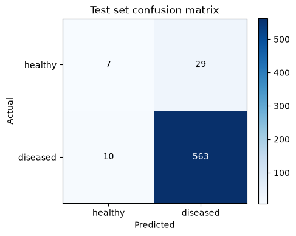
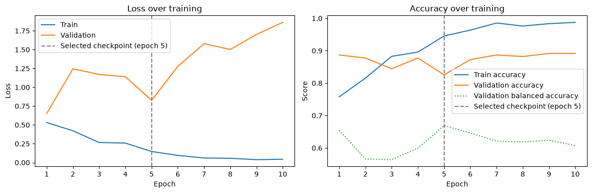

# Khula! Maize Crop Health Classifier

A ResNet18 transfer-learning prototype that classifies maize leaf photos as healthy or diseased, tested as a possible crop-health signal for an agri-finance funder dashboard.

## The business problem

[Khula!](https://www.khula.co.za/) is a South African agritech company. Farmers use its app to apply for production finance, and its Funder Dashboard connects them with institutional funders. Many smallholders cannot offer the collateral banks usually ask for, so funders rely on other information to judge risk.

Production finance is paid out before the crop is harvested, so most of the risk builds up while the crop is in the ground. If disease wipes out a crop, the lender usually only finds out when the harvest fails and a repayment is missed. A signal that shows crop condition during the season, taken from photos farmers can already take on their phones, could give funders an earlier warning. This project tests whether a simple image classifier can produce that signal.

A binary healthy/diseased output was chosen over disease-specific labels, because a funder needs to know whether a crop is at risk, not which pathogen is responsible.

## Dataset

- **Source:** [Maize_in_Field_Dataset](https://www.kaggle.com/datasets/hamishcrazeai/maize-in-field-dataset) on Kaggle, from [Craze et al. (2022)](https://doi.org/10.3390/plants11151942)
- **Licence:** CC BY-NC-SA 4.0. The images are not in this repo; see [data/README.md](data/README.md) to download them.
- **Contents:** 2355 maize leaf photos taken in the field in Mpumalanga, KwaZulu-Natal and the Eastern Cape, on cameras ranging from smartphones to an SLR. Each image has 8 multi-label columns (five named diseases, "no foliar symptoms", "other", "unidentified disease").
- **After cleaning:** 2328 images (27 exact duplicate pairs removed), 2102 diseased and 226 healthy, an imbalance of 9.3 : 1. Always predicting "diseased" would score 90.1% accuracy on the full dataset.

## Approach

The model and training setup follow the PyTorch [Transfer Learning for Computer Vision tutorial](https://docs.pytorch.org/tutorials/beginner/transfer_learning_tutorial.html) ("finetuning the ConvNet"). Most of the work went into the data handling around it.

**Target.** An image is "diseased" if any disease, "other" or "unidentified" flag is set, and "healthy" if only "no foliar symptoms" is set. 53 rows had both a disease flag and "no foliar symptoms"; these were labelled diseased, because a false "healthy" is the more costly error for a lender.

**Duplicate detection.** Every image was MD5-hashed. This found 27 byte-identical pairs saved under names that differ only by a "(1)". One copy of each was dropped so the same photo could not appear in both training and test.

**Group-aware split to prevent leakage.** Many photos are of the same plot or were taken on the same day, so a random image-level split would leak near-duplicates into the test set. Group IDs were extracted from the filenames in three tiers: plot codes where present (619 images), otherwise the capture date as a shoot-session ID (1475 images), otherwise the image on its own (261 images). Healthy images turned out to sit in only 19 of 361 groups, with one session holding 42.5% of them. `StratifiedGroupKFold` gave poor class balance on this data (one fold got 21 healthy images against roughly 45 expected), so groups were assigned to splits by a two-stage greedy rule: healthy-containing groups first, then diseased-only groups. No group appears in more than one split.

| Split | Images | Healthy | Healthy % |
|---|---|---|---|
| Train | 1507 | 164 | 10.9% |
| Validation | 212 | 26 | 12.3% |
| Test | 609 | 36 | 5.9% |

The target was 64/16/20; the result is 64.7/9.1/26.2, because three large session groups (575, 417 and 357 images) cannot be divided.

**Preprocessing.** Images vary in size (14 distinct dimensions) and orientation (1889 landscape, 439 portrait). Instead of the tutorial's crops, which can cut off lesions, each image's longer side is resized to 224 px and the shorter side padded. Training images get a random horizontal flip. A custom `Dataset` reads images in place (copying them into class folders for `ImageFolder` ran out of disk space), and JPEGs are decoded at reduced scale, which cut CPU training time from over three hours to 54 minutes.

**Training.** ResNet18 pretrained on ImageNet, all layers fine-tuned. SGD (lr 0.001, momentum 0.9) with StepLR (×0.1 every 7 epochs), as in the tutorial. Changes from the tutorial: class-weighted cross-entropy (healthy 4.595, diseased 0.561), batch size 32 instead of 4 so most batches contain a healthy image, and 10 epochs instead of 25.

**Checkpoint selection by balanced accuracy.** The tutorial keeps the epoch with the best validation accuracy, which on a 9:1 split rewards predicting "diseased" for everything. This project keeps the epoch with the best validation balanced accuracy (mean of healthy and diseased recall) instead: 66.9% at epoch 5.

## Results

Test set: 609 images from groups never seen in training or validation.

| Metric | Value |
|---|---|
| Accuracy | 93.6% |
| Majority-class baseline (always "diseased") | 94.1% |
| Balanced accuracy | 58.8% (bootstrap 95% CI 52.7% to 65.6%) |
| Healthy recall / precision | 0.19 / 0.41 |
| Diseased recall / precision | 0.98 / 0.95 |
| Diseased leaves predicted healthy | 10 of 573 (1.7%) |



The model recognised 7 of 36 healthy test leaves and flagged the other 29 as diseased.



The figures above, and the sample leaf photos in the notebook outputs, come from a model trained on the [Maize_in_Field_Dataset](https://www.kaggle.com/datasets/hamishcrazeai/maize-in-field-dataset) by Craze, Pillay, Joubert and Berger, used under [CC BY-NC-SA 4.0](https://creativecommons.org/licenses/by-nc-sa/4.0/). The leaf photos in the notebook were resized and padded to 224 px by the preprocessing step.

## Limitations and an honest reading of the results

- **It does not beat the baseline on accuracy.** 93.6% is 0.5 points below always predicting "diseased" (one-sided p = 0.697). Accuracy is the wrong headline number here.
- **The signal is real but weak.** The balanced accuracy interval (52.7% to 65.6%) sits above the 50% of a trivial classifier, but not by much.
- **Overfitting.** Training loss fell from 0.53 to 0.04 and training accuracy reached 98.7%, while validation loss rose from 0.65 to 1.86. With only 164 healthy training images the model memorises the training set.
- **The test set is about 94% diseased.** With only 36 healthy test images, the healthy-class metrics rest on very few examples. The validation set has 26 healthy images, so each one moves validation balanced accuracy by about 1.9 points and the choice of epoch 5 is noisy.
- **Errors are concentrated, not random.** All 39 test errors come from three groups. In two of them (`session_20190316` and `plot_R-Pn-DK-28`), none of the healthy leaves were recognised. The model seems to have learned what "healthy" looks like under the lighting, background and camera of the training sessions, and that does not carry over to a new shoot day or plot. A random image-level split would have hidden this.
- **What that means for Khula!** Farmers' photos would all come from new "sessions", which is exactly where this model fails. Its main error, flagging healthy crops as diseased, would mark creditworthy farmers as risky. It is a working proof of concept, not something to put in front of funders. Next steps would be more healthy images from varied conditions, higher-resolution inputs or tighter crops on the leaf, and validation against real repayment data.
- **Licence.** The dataset is non-commercial, so production use would need the authors' permission or Khula!'s own photos.

## Big data perspective

The second part of the assignment ([reports/big_data_analysis.docx](reports/big_data_analysis.docx)) looks at a different data source for the same problem: Sentinel-2 satellite imagery of farmers' fields, available free through Digital Earth Africa. It works through the "Vs" of big data for a small fintech:

- **Volume:** the full archive is far too large to download, so Khula! would process it in the cloud and keep only a history per financed field.
- **Variety:** unstructured rasters, semi-structured scene metadata and Khula!'s structured loan records have to be joined on field, borrower and date.
- **Velocity:** new passes every few days suit scheduled batch processing, not real-time streaming.
- **Variability and veracity:** cloud cover leaves gaps, a change in how scenes are processed means older and newer images must be harmonised, and small fields produce mixed edge pixels.
- **Validity and value:** crop condition is not creditworthiness, so the signal must be checked against repayment data. The conclusion is to use it as an in-season early-warning input, not a stand-alone approval score. It would also address the Part A finding that leaf photos did not generalise to new field sessions.

## How to run

You need Python 3.11 and the dataset, which is large, so check your free disk space. Training ran on CPU in 54 minutes.

```bash
git clone https://github.com/gopolangmmutlwane/khula-maize-crop-health-computer-vision.git
cd khula-maize-crop-health-computer-vision
python -m venv .venv
```

Activate the environment (`.venv\Scripts\activate` on Windows, `source .venv/bin/activate` on macOS/Linux), then:

```bash
pip install -r requirements.txt
```

Download the dataset into `data/` as described in [data/README.md](data/README.md), then open `notebooks/maize_crop_health_classifier.ipynb` in Jupyter or VS Code and run all cells. Seeds are fixed at 42, but results can still vary slightly between machines and library builds.

## Repository layout

```
├── README.md
├── LICENSE
├── requirements.txt
├── data/README.md                          how to get the dataset
├── images/                                 figures used in this README
├── notebooks/maize_crop_health_classifier.ipynb
└── reports/
    ├── cv_prototype_report.docx            Part A report
    └── big_data_analysis.docx              Part C report
```

## Licence

This repository is licensed under [CC BY-NC-SA 4.0](LICENSE), the same licence as the dataset, because the notebook outputs include images from it.

The training code (model setup, training loop and the prediction-display function) is adapted from the PyTorch [Transfer Learning for Computer Vision tutorial](https://docs.pytorch.org/tutorials/beginner/transfer_learning_tutorial.html), which is published under the [BSD-3-Clause licence](https://github.com/pytorch/tutorials/blob/main/LICENSE).

## Credits

- Model and training loop adapted from the PyTorch [Transfer Learning for Computer Vision tutorial](https://docs.pytorch.org/tutorials/beginner/transfer_learning_tutorial.html) by Sasank Chilamkurthy.
- Dataset: H.A. Craze, N. Pillay, F. Joubert and D.K. Berger, [Maize_in_Field_Dataset](https://www.kaggle.com/datasets/hamishcrazeai/maize-in-field-dataset) (CC BY-NC-SA 4.0), described in [*Plants* 11(15), 1942 (2022)](https://doi.org/10.3390/plants11151942).

## Academic context

Submitted for the Data Science in Finance module (DSF182), assessment SS2, part of the Postgraduate Diploma in Data Science at STADIO Higher Education. Graded 80/80. Part B of the assessment was a peer review of another student's work and is not included.

## Author

Gopolang Mmutlwane

- GitHub: [github.com/gopolangmmutlwane](https://github.com/gopolangmmutlwane)
- Portfolio: [gopolang-mmutlwane.onrender.com](https://gopolang-mmutlwane.onrender.com)
- LinkedIn: [linkedin.com/in/gopolang-mmutlwane-016250437](https://www.linkedin.com/in/gopolang-mmutlwane-016250437)
